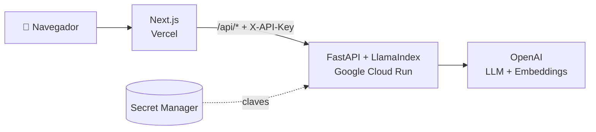

# 📚 Chat con tus documentos — RAG con LlamaIndex, FastAPI y Next.js

Aplicación **RAG (Retrieval-Augmented Generation)** para conversar con tus propios documentos.
Subes uno o varios archivos (PDF, TXT o MD) y haces preguntas: las respuestas se generan a partir
de su contenido e indican **de qué archivo y página** sale cada fuente.

🔗 **Demo:** https://rag-llamaindex-frontend.vercel.app

---

## ✨ Funcionalidades

- 📄 **Varios documentos a la vez** (hasta 10): las preguntas buscan en todos.
- 💬 **Chat con historial** y respuestas en Markdown.
- 📎 **Fuentes citadas**: archivo, página y relevancia de cada fragmento usado.
- ⚡ **Indexación incremental**: al agregar o quitar un documento solo se procesa ese archivo
  (no se regeneran los embeddings de los demás).
- 🗑️ **Eliminar documentos** de forma individual, con confirmación.
- 🔒 **API protegida** con clave; la clave **nunca llega al navegador**.
- 💸 **Costos mínimos**: `gpt-5.4-nano` + `text-embedding-3-small`, y despliegue que escala a cero.

## 🏗️ Arquitectura



- **Frontend (Next.js en Vercel):** la interfaz. Sus rutas de servidor `/api/*` reenvían las
  peticiones al backend añadiendo la `API_KEY`, que vive solo en el servidor de Vercel.
- **Backend (FastAPI en Cloud Run):** carga los documentos, los divide en fragmentos, genera
  embeddings, mantiene el índice vectorial y responde las preguntas con LlamaIndex.
- **Secretos:** `OPENAI_API_KEY` y `API_KEY` se guardan en Google Secret Manager; no están en el
  código ni en la imagen Docker.

### Flujo RAG

1. **Carga** del documento (PDF por páginas, TXT o MD).
2. **Chunking**: fragmentos de 512 tokens con 100 de solapamiento (`SentenceSplitter`).
3. **Embeddings** con `text-embedding-3-small`.
4. **Índice vectorial** en memoria (`VectorStoreIndex`).
5. **Consulta**: se recuperan los fragmentos más relevantes y `gpt-5.4-nano` genera la respuesta.

## 🧰 Stack

| Capa | Tecnologías |
|------|-------------|
| Frontend | Next.js 16, React 19, TypeScript, react-markdown |
| Backend | Python 3.12, FastAPI, Uvicorn, LlamaIndex |
| IA | OpenAI `gpt-5.4-nano`, `text-embedding-3-small` |
| Infraestructura | Docker, Google Cloud Run, Cloud Build, Artifact Registry, Secret Manager, Vercel |

## 📁 Estructura

```
backend/
├── app/
│   ├── main.py              # endpoints FastAPI
│   └── rag/rag.py           # carga, chunking, embeddings, índice y consulta
├── config/model_config.yaml # modelos (LLM y embeddings)
├── Dockerfile               # imagen del backend
├── cloudbuild.yaml          # build y push de la imagen
├── service.yaml             # configuración del servicio en Cloud Run
└── requirements.txt
frontend/
├── app/                     # página principal y rutas /api/*
├── components/              # Sidebar, Chat, diálogo de eliminar
└── lib/                     # cliente del backend y tipos
```

## 🔌 API del backend

Todos los endpoints (menos `/health`) exigen la cabecera `X-API-Key`.

| Método | Ruta                 | Descripción                                          |
|--------|----------------------|------------------------------------------------------|
| GET    | `/health`            | Estado de la API                                     |
| GET    | `/documents`         | Lista de documentos cargados                         |
| POST   | `/documents`         | Agrega uno o varios archivos (PDF, TXT, MD)          |
| DELETE | `/documents/{name}`  | Quita un documento del índice                        |
| DELETE | `/documents`         | Quita todos los documentos                           |
| POST   | `/query`             | Pregunta sobre los documentos: `{"question": "..."}` |

Documentación interactiva (Swagger) en `/docs`.

## 🚀 Ejecutar en local

**Requisitos:** Python 3.12+, Node.js 20+ y una clave de OpenAI.

### 1. Backend

```bash
cd backend
pip install -r requirements.txt
cp .env.example .env        # completa OPENAI_API_KEY y API_KEY
python -m uvicorn app.main:app --host 127.0.0.1 --port 8000 --reload
```

### 2. Frontend

```bash
cd frontend
npm install
cp .env.example .env.local  # BACKEND_URL=http://127.0.0.1:8000 y la misma API_KEY
npm run dev
```

Abre http://localhost:3000

## ☁️ Despliegue

### Backend → Google Cloud Run

```bash
cd backend
gcloud builds submit --config=cloudbuild.yaml                      # construye y sube la imagen
gcloud run services replace service.yaml --region us-central1      # despliega el servicio
gcloud run services set-iam-policy servicio-rag-fastapi gcr-service-policy.yaml --region us-central1
```

Las claves se leen de Secret Manager (`OPENAI_API_KEY` y `RAG_API_KEY`). Para una versión nueva,
cambia la etiqueta de la imagen (`v2` → `v3`) en `cloudbuild.yaml` y `service.yaml`.

### Frontend → Vercel

```bash
cd frontend
npx vercel env add BACKEND_URL production   # URL del servicio de Cloud Run
npx vercel env add API_KEY production       # misma API_KEY del backend (tipo Secret)
npx vercel --prod
```

## ⚠️ Limitaciones y próximos pasos

- Los documentos viven **en memoria**: se pierden cuando Cloud Run escala a cero. Próximo paso:
  una base de datos vectorial (pgvector, Qdrant…) y almacenamiento de archivos en Cloud Storage.
- Todos los visitantes comparten los mismos documentos: falta **autenticación de usuarios**.
- Despliegue manual: falta **CI/CD** con GitHub Actions o Cloud Build Triggers.

## 👤 Autor

**Jeanpier Ancori Sánchez** — proyecto desarrollado en el curso de Datapath.
